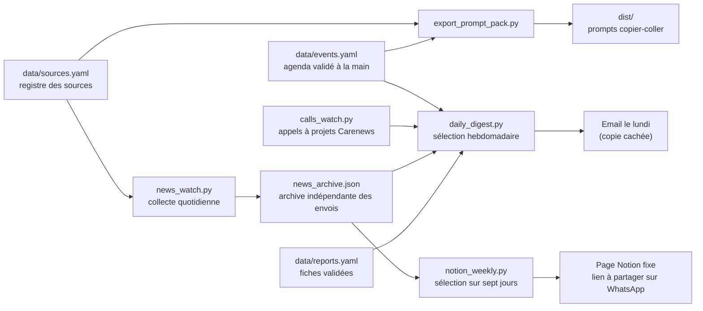

# veille-nif – Veille Nature in Finance

Outil de veille sur la finance durable, axe nature et biodiversité, pour la communauté Nature in Finance. Périmètre : France, Europe, Suisse, Royaume-Uni, avec quelques références internationales (TNFD, ISSB, CBD, IPBES).

Il produit trois choses :
1. **Une page Notion hebdomadaire à lien fixe** : sélection de la semaine civile précédente et agenda à 60 jours, sans propriétés techniques, à partager sur WhatsApp.
2. **Une newsletter hebdomadaire** : actualités par rubrique, synthèses de rapports validées, agenda court et appels à projets ouverts.
3. **Des versions « copier-coller »** pour Claude, ChatGPT ou tout autre assistant (`dist/`).

La collecte et l’hebdomadaire tournent en Python dans GitHub Actions, **sans appel à un modèle d’IA ni consommation de tokens**. La collecte est quotidienne ; l’email et la page hebdomadaire sont publiés uniquement le lundi. Aucun agent ni abonnement de crédits Warp n’est nécessaire à leur exécution. L’usage reste soumis aux limites des services GitHub et Notion.

## Comment ça marche



- **Actualités** (`src/news_watch.py`) : flux RSS, requêtes Google News `site:` et requêtes thématiques par zone/langue. Les filtres couvrent aussi la science sans condition de vocabulaire financier et la réglementation CSRD/SFDR/ISSB. Chaque article conserve sa source, sa zone de recherche, ses thèmes, son axe éventuel, son niveau d’autorité et les restrictions d’accès connues.
- **Agenda** (`src/events_watch.py`) : lit `data/events.yaml`, un agenda tenu à la main. Aucun événement n’y entre sans vérification sur une source officielle. Le script cherche aussi des événements candidats, écrits dans `data/interim/events_candidates.csv` pour relecture, jamais dans l’agenda.
- **Appels à projets** (`src/calls_watch.py`) : lit la liste publique de Carenews, filtre sur la nature et l’agriculture, signale les appels nouveaux ou qui se clôturent sous 14 jours.
- **Newsletter** (`src/daily_digest.py`, `src/editorial.py`) : collecte chaque jour à partir de 06 h UTC, diffusion le lundi seulement (07 h en hiver ou 08 h en été à Paris). La diffusion intervient après le traitement, avec les éventuels délais de GitHub : ce n’est pas une garantie de réception à 06 h précises. L’édition retient au plus 15 articles publiés pendant la semaine civile précédente en UTC, avec une place réservée à la science sans la placer systématiquement en tête. Le classement privilégie les annonces de mobilisation de capitaux pour le vivant, les autres financements et les projets concrets. L’autorité de la source, son rattachement au registre et la récence départagent ensuite les contenus. Ce classement lexical est un repère éditorial, pas une validation de chaque affirmation ni de l’impact annoncé.
- **Archive et états** (`src/news_archive.py`) : les contenus collectés sont conservés dans `data/output/news_archive.json` avant l’envoi. L’historique `data/interim/newsletter_delivery.json` ne marque comme diffusés que les articles et rapports effectivement envoyés. Un plafond de sélection ou un échec d’email ne supprime pas l’archive. Les articles non retenus restent archivés, mais ne sont plus candidats à l’email une fois leur période éditoriale dépassée.
- **Page hebdomadaire** (`src/notion_weekly.py`) : une page de lecture ordinaire, sans les propriétés de la base. Couverture photographique de forêt, voile émeraude et titre à empattements, cartes de chiffres clés, trois signaux à retenir, sélection de 15 actualités par rubrique et agenda bleu. Les tags détaillés restent dans la bibliothèque, pas sur la page publique.

## Ligne éditoriale : financer le vivant

La veille aide le collectif à passer des idées à l’action et à flécher davantage de financements vers le vivant. Elle relie finance, ONG, scientifiques, économistes, entreprises et acteurs publics : fonds biodiversité, économie bleue, restauration des écosystèmes, eau, paiements pour services écosystémiques et partenariats de terrain. La science et la réglementation restent présentes comme leviers de décision, sans réduire la veille à la conformité ESG.

Les offres d’emploi, stages, recrutements, concours, trophées, nominations de dirigeants, récapitulatifs généralistes et pages de navigation sont écartés de la sélection principale, y compris s’ils sont déjà archivés. Les reprises d’annonces de financement sont rapprochées lexicalement pour éviter qu’un lancement de fonds occupe plusieurs places. Ce rapprochement peut confondre des sujets proches ; la bibliothèque conserve les ressources originales.

ESG Today est collecté sur quatre pages RSS au maximum, au lieu de la seule page récente. Les articles individuels sur les fonds biodiversité, l’économie bleue, l’eau et la déforestation sont retenus selon leur pertinence ; ni la newsletter complète ni ses publicités ne sont reproduites. Une annonce reste une annonce : un montant cible n’est pas un montant déjà levé et un objectif écologique n’est pas un résultat mesuré.

## Structure de l’hebdomadaire

1. **Financement et marchés** : mobilisation des capitaux pour la nature.
2. **Pratiques et engagements** : projets et partenariats.
3. **Réglementation et standards** : CSRD, SFDR, ESRS, IFRS/ISSB, TNFD.
4. **Science et génie écologique** : IPBES, INRAE, MNHN, CNRS, restauration et stratégies territoriales.
5. **Synthèses de rapports** : jusqu’à deux fiches lues et validées humainement ; sinon, l’absence de nouvelle fiche est indiquée.
6. **Agenda** : les cinq premières rencontres, avec un lien vers l’agenda complet à 60 jours.
7. **Opportunités** : types séparés « appels à projets et financements », « AO/RfP pour structures » et « missions de consultants indépendants ». À ce stade, seul le premier type est alimenté automatiquement, par Carenews ; une rubrique sans contenu est omise.

Les rubriques d’actualités vides sont omises ; l’absence de contenu scientifique est signalée explicitement. Une édition est envoyée chaque lundi même sans nouvelle actualité. Les liens d’archive et d’agenda pointent provisoirement vers les fichiers publics du dépôt, en attendant la vérification des vues publiques filtrées de la bibliothèque Notion.

## Installation locale

Python 3.12 ou plus récent, compatible Linux AMD64. Utiliser un environnement virtuel.

```bash
python3 -m venv .venv
.venv/bin/pip install -r requirements.txt
.venv/bin/python -m unittest discover -s tests -v          # tests, hors réseau
.venv/bin/python src/daily_digest.py --dry-run --html-out /tmp/veille.html   # aperçu sans envoi ni état
```

Autres commandes utiles :

- `.venv/bin/python src/daily_digest.py --weekly` : collecte ; envoie uniquement le lundi UTC et évite un second envoi planifié de la même édition.
- `.venv/bin/python src/daily_digest.py --collect-only` : archive la collecte sans email.
- `.venv/bin/python src/daily_digest.py --dry-run --max-articles 12` : aperçu avec plafond différent.
- `.venv/bin/python src/news_watch.py --check-sources` : vérifie chaque source et flux.
- `.venv/bin/python src/events_watch.py` : affiche l’agenda complet ; `--check-links` vérifie les liens ; `--candidates` cherche des événements à valider.
- `.venv/bin/python src/calls_watch.py` : affiche les appels à projets ouverts.
- `.venv/bin/python src/export_prompt_pack.py` : régénère `dist/` ; `--no-network` omet la collecte Carenews.
- `.venv/bin/python src/notion_weekly.py --dry-run --json-out /tmp/notion-weekly.json` : composer la page sans jeton ni écriture Notion.

Attention : sans `--weekly`, `--collect-only` ou `--dry-run`, `daily_digest.py` effectue un envoi immédiat. `--ignore-seen` permet un rejeu de test sans modifier les historiques de collecte et de diffusion ; il faut ajouter `--dry-run` pour ne pas envoyer.

## Mise en route de l’envoi automatique

1. Dans GitHub, **Settings > Secrets and variables > Actions**, créer les secrets suivants. Aucun n’est dans le dépôt, qui est public.
   - `DIGEST_FROM` : la boîte d’expédition.
   - `DIGEST_TO` : les destinataires de la communauté, séparés par des virgules. Ils sont toujours en copie cachée.
   - Pour Microsoft 365 : `GRAPH_TENANT_ID`, `GRAPH_CLIENT_ID`, `GRAPH_CLIENT_SECRET` (permission applicative `Mail.Send`, idéalement restreinte à la boîte d’expédition).
   - Pour un SMTP classique : `EMAIL_BACKEND=smtp`, `SMTP_HOST`, `SMTP_PORT`, `SMTP_USER`, `SMTP_PASSWORD`.
2. Lancer le workflow **Collecte quotidienne et veille hebdomadaire Notion** avec `dry_run` coché : les aperçus sont composés quel que soit le jour, sans email, écriture Notion ni modification d’état durable.
3. Après validation du dry run et déploiement du workflow sur `main`, laisser GitHub collecter chaque jour à 06 h UTC (`0 6 * * *`) ; les scripts limitent l’email et la page hebdomadaire au lundi, sans envoi quotidien. Une première collecte avec `lookback_days = 7` peut élargir la recherche ; l’archive quotidienne alimente ensuite la sélection sur sept jours. Les articles déjà traités par l’ancienne veille quotidienne ne sont pas réexpédiés lors de la migration.
4. Pour un envoi immédiat volontaire, cocher `send_now` et décocher `dry_run`. Pour un rejeu incluant des articles déjà vus, cocher aussi `ignore_seen` ; les historiques ne sont pas modifiés par ce rejeu.
5. Pour actualiser uniquement la page Notion, cocher `publish_now` et laisser `send_now` décoché : l’étape d’email est alors ignorée, même le lundi. Cocher aussi `send_now` uniquement pour demander explicitement les deux publications.

Pour une reprise à partir d’un jour précis, renseigner `start_date` au format `YYYY-MM-DD`, par exemple `2026-11-02`. Cette borne incluse commence à 00 h UTC et s’applique aux dates de publication de la collecte et à la sélection de la page Notion, y compris les articles déjà archivés. Les dates absentes ou illisibles sont exclues dans ce mode. La recherche est élargie automatiquement si nécessaire, sans garantie d’exhaustivité des flux. L’archive antérieure est conservée. Laisser ce champ vide pour les éditions habituelles ; la sélection de l’email reste indépendante et n’est pas modifiée par cette borne manuelle.

Pour changer d’adresse d’expédition, modifier uniquement le secret `DIGEST_FROM` (et l’application Graph si besoin) : aucun changement de code.

### Validation et programmation sans tokens

Le planificateur est celui de **GitHub Actions**, pas un agent Warp. Warp peut servir à développer et à lancer les commandes de contrôle, mais aucun run d’agent n’intervient dans l’automatisation récurrente.

- Dépôt : `eplr/veille-nif`, branche `main`, workflow `veille.yml`.
- Cron quotidien : `0 6 * * *`, **06 h UTC**, sans changement saisonnier.
- Publication : uniquement le lundi grâce à `--weekly`, après la collecte. Aucun email quotidien n’est envoyé.
- Les secrets d’envoi et Notion restent dans GitHub Actions ; aucune clé d’API de modèle d’IA n’est nécessaire.
- Le contrôle des liens dans `ci.yml` le lundi ne publie rien et reste indépendant.

**Édition du lundi 9 novembre 2026** : déclenchement à **07 h, heure de Paris (CET, UTC+1)**, soit 06 h UTC. Elle couvre les actualités du 2 au 8 novembre. La collecte et la composition précèdent l’envoi ; annoncer une diffusion « à partir de 7 h » plutôt qu’une réception garantie à 7 h précises. Les délais de GitHub Actions et de la messagerie peuvent retarder la réception.

Avant déploiement :

1. Exécuter les tests locaux dans `.venv`.
2. Déclencher un aperçu GitHub sur sept jours :

```bash
gh workflow run veille.yml --repo eplr/veille-nif --ref main \
  -f lookback_days=7 -f dry_run=true -f ignore_seen=false \
  -f send_now=false -f publish_now=false
```

3. Suivre le run retourné et vérifier sa conclusion. Le dry run compose l’email et la page sans envoi, écriture Notion ni modification durable de `data/` ou `dist/`. Après déploiement du workflow mis à jour, l’artefact `veille-nif-dry-run` conserve pendant sept jours l’aperçu HTML, les blocs Notion et la collecte JSON.
4. Vérifier que les étapes de synchronisation Notion et de persistance sont ignorées, puis relire les aperçus. Un dry run ne teste pas l’authentification réelle d’envoi ni les droits d’écriture Notion.
5. Déployer le workflow validé sur `main` pour appliquer le nouvel horaire. Le cron déjà présent dans le dépôt suffit : ne créer aucune programmation d’agent Warp.

En fonctionnement planifié, les indicateurs `send_now`, `publish_now` et `ignore_seen` sont inactifs. Les scripts gardent leur protection du lundi et de l’édition déjà envoyée ; le groupe de concurrence GitHub sérialise les traitements.

L’épuisement de crédits Warp n’a aucun effet sur cette automatisation. En revanche, les quotas et incidents GitHub, Notion ou du service de messagerie restent applicables. Ne pas relancer aveuglément après une erreur : vérifier l’historique d’envoi et le résultat de la page Notion, puis choisir une reprise contrôlée.

Point de vigilance : GitHub désactive les workflows planifiés d’un dépôt public resté 60 jours sans activité. Le workflow enregistre son passage dans `data/last_run.txt`. L’étape de persistance s’exécute aussi après un échec d’email ou d’export pour conserver la collecte ; une panne de GitHub ou du push peut toutefois empêcher cet enregistrement. Après un échec d’envoi le lundi, relancer le même jour ou utiliser volontairement `send_now` : les jours suivants ne déclenchent pas de rattrapage automatique.

## Ajouter une source

Ouvrir `data/sources.yaml`, copier une ligne, renseigner `rss` si un flux valide existe, sinon `domaine` (Google News `site:`). Choisir le filtre : `aucun`, `mots_cles`, `mots_cles_large`, `science` ou `reglementation`. Le filtre scientifique accepte notamment le génie écologique et la restauration sans mention de finance ; le filtre réglementaire accepte CSRD/SFDR/ISSB sans mention explicite de nature.

La section `profils` définit l’autorité par catégorie ; une source peut la surcharger avec `autorite: primaire|analyse|presse|communication`. `axe: science|reglementation|financement|pratiques` force une rubrique lorsque cela se justifie. `acces: abonnement` signale un accès payant connu (AEF Info) ; aucun contenu protégé n’est contourné. La disponibilité d’un domaine ne garantit pas son indexation exhaustive par Google News.

Les sources ajoutées sont Vert, Boursorama, AEF Info, ESG Today, IFRS/ISSB, INRAE, MNHN et CNRS. ESG Today reste classée « International », car sa couverture ne se limite pas aux États-Unis. IPBES est rattachée à la recherche.

CINEA/LIFE et l’AFD complètent les sources sur les financements et leur mise en œuvre. Leurs actualités sont recherchées par domaine ; cela ne constitue pas encore un connecteur structuré vers leurs appels à projets. `rss_pages` active une pagination WordPress bornée (1 par défaut, 4 pour ESG Today).

`canaux_complementaires` recense séparément les événements Finance for Biodiversity, les financements européens et les marchés/missions du Green Climate Fund. Ce sont des points d’entrée documentés, pas encore des collecteurs actifs. CSP reste à identifier ; Symbiosis et les fondations américaines restent à préciser. Vérifier ensuite les sources avec `.venv/bin/python src/news_watch.py --check-sources`.

## Ajouter une synthèse de rapport

Compléter `data/reports.yaml` selon le modèle commenté : identifiant de version stable, référence, URL du rapport, date de publication, date de vérification, résultats avec pages justificatives, méthode, limites et implications pratiques. Mettre `valide: true` seulement après lecture et relecture humaine.

Les fiches validées pendant les sept derniers jours sont proposées à l’édition, dans la limite de deux et sans renvoyer un identifiant déjà diffusé. Une nouvelle version substantielle doit porter un nouvel identifiant. Aucun résumé automatique ni appel à une API d’IA n’a été ajouté.

## Ajouter un événement

Ouvrir `data/events.yaml`, copier un bloc, renseigner tous les champs obligatoires, dont `source` (la page officielle consultée) et `verifie_le`. Si une information vient d’une source secondaire ou est déduite, mettre `confiance: moyenne` : l’email affichera « à revérifier ». Le chargement valide le fichier et signale toute erreur de saisie.

## Utiliser la version copier-coller

- `dist/prompt_autonome.md` : à coller dans un assistant qui sait chercher sur le web. Il demande une veille sur 7 jours, un agenda à 60 jours et les appels à projets, avec des garde-fous (pas d’invention, « Rien de vérifié trouvé » plutôt qu’une section remplie de mémoire).
- `dist/pack_avec_pieces_jointes.md` : pour un assistant sans accès au web. Même consigne, avec en pièces jointes les sources, l’agenda, les appels à projets ouverts et les actualités récentes détectées.

Dans les deux cas, vérifier les liens avant de citer une information.


## Bibliothèque Notion

Le connecteur `src/notion_sync.py` synchronise les données publiques locales vers la base Notion, sans télécharger ses contributions privées dans le dépôt. Il utilise l’API Notion version `2026-03-11`, avec les identifiants de **source de données**, distincts des identifiants de base.

Configuration GitHub Actions :
- secret `NOTION_TOKEN` : jeton de l’intégration interne autorisée sur la base ;
- variable `NOTION_DATA_SOURCE_ID` : identifiant de la source de données qui contient les propriétés ;
- variable `NOTION_WEEKLY_PAGE_ID` : identifiant de la page publique fixe, conservé pendant la migration ;
- variable `NOTION_LIBRARY_URL` : lien public vers la vue d’accueil de la bibliothèque ;
- permissions Notion : lecture, insertion et modification du contenu. Aucun accès aux données des utilisateurs n’est nécessaire.

Le jeton n’est jamais fourni en argument, dans un fichier ou dans les journaux. Les variables nécessaires doivent être injectées dans l’environnement par un mécanisme sûr.

```bash
.venv/bin/python src/notion_sync.py --init-schema --dry-run  # prévisualiser les propriétés manquantes
.venv/bin/python src/notion_sync.py --init-schema            # migration additive, sans suppression
.venv/bin/python src/notion_sync.py --check-schema
.venv/bin/python src/notion_sync.py --dry-run                # lire et comparer, sans écrire
.venv/bin/python src/notion_sync.py --limit 5                # synchronisation réelle limitée
.venv/bin/python src/notion_sync.py                          # articles des 14 derniers jours
.venv/bin/python src/notion_sync.py --days 0                 # reprendre tout l’historique d’articles
```

### Contenus et propriétés

Le connecteur reprend l’archive JSON et le journal CSV des actualités, l’agenda complet (y compris ses événements passés pour conserver l’historique), toutes les fiches de rapports validées et le dernier instantané des appels. Les types « actualité », « rapport », « événement », « financement », « AO/RfP pour structures » et « mission de consultant » sont séparés.

La migration conserve `Nom` et ajoute les propriétés absentes : identifiant technique, type, URL, source, publication, détection, dates d’événement, clôture, thématiques, mots-clés, écosystèmes, zone, rubrique, autorité, accès, origine, validation, vérification, lieu, horaires, contenu source, notes, dernière diffusion et dernière synchronisation. Un type de propriété incompatible arrête le traitement au lieu de convertir ou supprimer des données.

Les articles et opportunités issus de la collecte entrent **« À valider »**, jamais automatiquement « Validé ». L’agenda reprend la validation éditoriale locale et marque **« À revérifier »** les événements à confiance moyenne ; les fiches de rapports déjà relues entrent « Validé ». La dernière diffusion n’est renseignée que lorsque l’historique de la newsletter fournit une date connue.

Après création, **`Validation`, `Vérifié le`, `Notes` et `Écosystèmes` ne sont jamais réécrits**. Le corps des pages n’est pas modifié. Les autres propriétés des fiches gérées par le connecteur reflètent les sources locales ; pour conserver une annotation ou une correction éditoriale, utiliser `Notes` ou le corps de page. Ne pas modifier `Identifiant sync`, qui sert au rapprochement.

### Doublons, reprises et cadence

L’identifiant stable utilise l’URL pour les articles/opportunités, et l’identifiant local pour les événements/versions de rapports. Les paramètres publicitaires usuels et fragments sont ignorés pour le rapprochement. Les mises à jour ne sont envoyées que si les propriétés ont changé ; une seconde passe identique ne modifie rien.

Les entrées manuelles portant déjà la même URL sont ignorées, pas absorbées ni remplacées. Le connecteur ne supprime aucune fiche et ne recrée pas les fiches archivées accessibles à la requête API. Des identifiants techniques distants en double provoquent une erreur avant écriture.

Le workflow actualise chaque jour les appels avec `src/calls_watch.py --snapshot`, puis synchronise Notion, même si l’email a échoué. Une panne Carenews conserve l’instantané précédent ; une panne Notion est signalée par l’échec de l’étape, sans empêcher la persistance de la collecte. Les essais `dry_run` du workflow ne déclenchent aucune écriture Notion.

Les requêtes sont paginées et limitées en débit ; les réponses de quota respectent `Retry-After`. Une création avec résultat réseau incertain n’est pas répétée aveuglément : relancer le script, qui relira les identifiants déjà présents. Notion n’impose pas d’unicité transactionnelle : conserver **un seul processus de synchronisation à la fois**, comme le fait le groupe de concurrence du workflow.

Cette première version est **unidirectionnelle vers Notion**. Modifier un statut dans Notion ne modifie pas encore la sélection de la newsletter et n’ajoute pas un événement communautaire à `data/events.yaml`. Le formulaire, le circuit de retour éditorial et WhatsApp restent des lots distincts. Si la base est publiée sur le web, vérifier les droits avant d’y ajouter des notes ou contributions confidentielles.

### Page publique hebdomadaire et lien WhatsApp

La page « Veille – Nature in Finance » est une **page ordinaire**, pas une ligne de base de données : elle ne possède que son titre. Une fiche « Gestion de la veille hebdomadaire », d’identifiant technique `veille-nif:weekly-publication:management`, reste dans la bibliothèque pour les métadonnées. La page de lecture est sa sous-page, repérée par `NOTION_WEEKLY_PAGE_ID`. La migration du prototype quotidien sauvegarde d’abord ses propriétés dans la fiche de gestion puis déplace la même page, sans changer son identifiant ni effacer son contenu. Un champ non copiable arrête la migration plutôt que de perdre une annotation. L’ancien `NOTION_DAILY_PAGE_ID` est accepté comme repli pendant cette transition.

La sélection suit la **semaine civile précédente en UTC**, du lundi 00 h inclus au lundi suivant 00 h exclu. Par exemple : **« Édition du 9 novembre 2026 »**, puis sur une ligne distincte **« Actualités du 2 au 8 novembre 2026 »**. Une prévisualisation dominicale porte déjà la date du lundi suivant ; l’instant réel de collecte reste indiqué dans « Sources et méthode ». Aucun article futur n’est ajouté pour compléter un aperçu avant la fin de la semaine. Les dates absentes, illisibles, futures ou sans heure sont exclues. Le plafond reste de 15 articles (`--max-articles`), avec une place pour la science et indépendamment de l’historique d’envoi de l’email.

`--edition-date 2026-11-09` fixe explicitement le lundi de diffusion ; le workflow expose le même champ `edition_date`, qui ne modifie que la page Notion. Laisser ce champ vide pour l’automatisation. `start_date` peut avancer ou reculer la borne de début d’une reprise manuelle, mais la fin reste celle de l’édition choisie.

La page présente une couverture haute définition (`assets/notion-cover.png`), trois chiffres clés lisibles sans colonnes étroites, trois liens « à retenir », les autres articles par rubrique et l’agenda à 60 jours. Les titres ne sont pas répétés dans plusieurs sections. Les sources, dates et accès payants restent visibles ; les tags et propriétés techniques restent dans la base. Un lien vers la bibliothèque est placé sous l’introduction et rappelé en bas de page.

Le pied de page affiche le dépôt `https://github.com/eplr/veille-nif` et la signature « © 2026 fidestra » ; le millésime suit automatiquement l’année de l’édition.

La couverture est téléversée une seule fois via l’API officielle, sans hébergement externe ni dépendance graphique à l’exécution. Une couverture choisie manuellement n’est pas remplacée, sauf demande explicite `--refresh-cover`. Les autres blocs utilisent les couleurs natives de Notion ; le thème du lecteur reste libre. Conserver les annotations dans `Notes` de la fiche de gestion ou dans des blocs **hors de la zone générée**.

Le workflow expose `refresh_cover` pour remplacer volontairement le visuel existant. La couverture est composée hors pipeline par `tools/render_cover.py` avec Pillow dans un venv et des chemins de polices explicites ; elle n’ajoute aucune dépendance au run hebdomadaire. Les crédits et la licence de la photo figurent dans `assets/credits.txt`. La typographie du titre est intégrée à l’image : le script ne peut pas imposer une police arbitraire au corps natif de la page Notion.

L’aperçu HTML utilise un fond vert profond, des liens bleu glacier et un encadré bronze pour les sources (`assets/weekly-preview.css`). Les contrastes de lecture ont été contrôlés à au moins 7:1. Cette palette CSS n’est pas injectée dans Notion : la page native conserve le thème du lecteur et ses couleurs de blocs. `tools/preview_weekly.py` génère un aperçu autonome depuis le JSON des blocs, avec la couverture intégrée au fichier pour éviter les images locales bloquées.

### Navigation de la bibliothèque

`src/notion_library.py --apply` prépare cinq vues : Toutes les ressources, Actualités, Rapports, Agenda et Opportunités. Les propriétés visibles sont limitées aux informations utiles à chaque vue ; les filtres rapides permettent de cibler type, thème, zone, validation et date. La vue d’origine reste disponible sous « Exploration détaillée ». Les vues publiques excluent les fiches de gestion et les ressources rejetées, sans supprimer de données. Les filtres et propriétés masquées ne sont pas une protection d’accès : les droits de partage de la base restent à contrôler séparément.

La configuration est manuelle, pas réappliquée à chaque collecte : les réglages de navigation peuvent ensuite être ajustés dans Notion. Sans `--apply`, le script affiche uniquement les opérations prévues.

Le programme prépare la nouvelle zone avant d’archiver la précédente. En cas d’échec partiel, l’ancienne édition complète reste disponible et une nouvelle exécution réconcilie les zones techniques. Seuls les sous-arbres explicitement marqués comme générés sont remplacés ; les autres contenus ne sont pas supprimés. Une publication identique ne réécrit pas les blocs et ne change jamais l’identifiant de page.

Pour rendre le lien utilisable sans compte Notion, ouvrir une première fois la page et choisir **Partager → Publier**, puis vérifier le lien en navigation privée. L’API officielle ne publie pas automatiquement la page : le script affiche `public_url` lorsqu’une URL publique est déclarée ; sinon il indique que la publication reste à confirmer. La version publique peut présenter un décalage temporaire après une modification : vérifier le contenu rendu, pas seulement l’état de l’API. Partager ce lien public fixe dans WhatsApp. Aucun message WhatsApp n’est envoyé automatiquement.

```bash
# Collecte de contrôle : sortie temporaire, aucun historique modifié.
.venv/bin/python src/news_watch.py --lookback-days 7 --dry-run --require-source-data --json-out /tmp/collecte.json
# Aperçu autonome des blocs.
.venv/bin/python src/notion_weekly.py --collection-file /tmp/collecte.json --dry-run --json-out /tmp/notion-weekly.json
# Publication réelle, variables Notion déjà injectées de façon sûre.
.venv/bin/python src/notion_weekly.py --collection-file /tmp/collecte.json
```

Le workflow collecte et alimente la bibliothèque chaque jour. Il actualise la page et envoie l’email **le lundi seulement**, après une collecte réussie. Les deux publications sont indépendantes : une panne d’email n’empêche pas la page. Une collecte illisible ne remplace pas l’ancienne édition par une page vide. `--weekly` applique ce garde du lundi ; sans ce flag, une publication manuelle est possible, sans email. L’affichage sans propriétés ne remplace pas le contrôle des droits de partage de la bibliothèque.


## Limites connues

- Google News trie par pertinence et non par date, et ses requêtes bruitent parfois les résultats ; les filtres par mots-clés réduisent ce bruit sans le supprimer. Les liens des articles passent par une redirection Google.
- Pour les articles issus des requêtes par zone, la zone indiquée est celle de l’édition de recherche, pas nécessairement le pays de l’éditeur.
- La lecture de Carenews dépend de la structure HTML de sa page. Si elle change, l’email le signale (« Source Carenews indisponible ») au lieu de masquer la panne.
- L’agenda est tenu à la main : il reste incomplet et nécessite une vérification régulière.
- L’autorité décrit la provenance, pas le degré de preuve de chaque article : la distinction prépublication/étude évaluée et engagement/résultat mesuré exige une lecture éditoriale.
- La synchronisation vers Notion est implémentée ; la reprise du chat WhatsApp, le retour des validations dans la newsletter et les contributions mensuelles restent à réaliser. Le dépôt étant public, ne pas y ajouter de coordonnées, d’exports de conversations privées ni de secrets.

## Licence

Deux licences, selon la nature du fichier. Titulaire des droits : fidestra.

- **Code** – licence MIT (`LICENSE`) : `src/`, `tests/`, `tools/`, `.github/`, `requirements.txt`. Réutilisation libre, y compris commerciale, en conservant l’avis de copyright.
- **Contenus et données** – licence CC BY 4.0 (`LICENSE-CONTENT`) : `assets/`, `dist/`, `data/`, `README.md` et les autres textes. Réutilisation libre, y compris commerciale et modifiée, à condition de citer la source et de signaler les modifications.

Attribution demandée pour les contenus :

> Veille Nature in Finance – fidestra, CC BY 4.0, https://github.com/eplr/veille-nif

Les contenus de tiers cités ou liés depuis le dépôt (articles de presse, textes réglementaires, pages d’événements, appels à projets) restent soumis à leurs propres conditions : ces licences ne portent que sur ce qui est produit dans le cadre du projet.

La photographie de la couverture reste sous licence Unsplash, distincte de CC BY 4.0 ; voir `assets/credits.txt`.

En contribuant, vous acceptez que votre apport soit diffusé sous la licence correspondant au fichier modifié.
