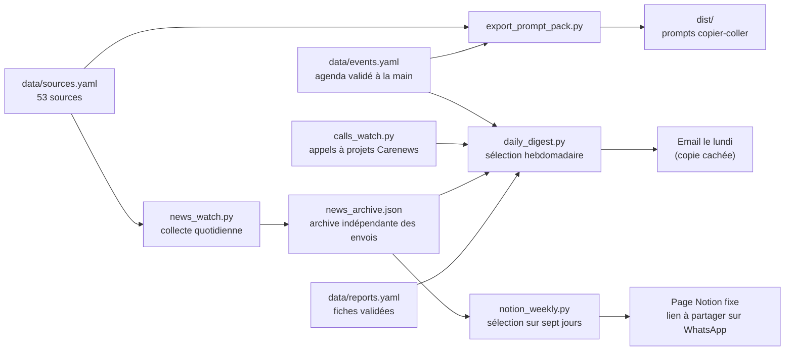

# veille-nif – Veille Nature in Finance

Outil de veille sur la finance durable, axe nature et biodiversité, pour la communauté Nature in Finance. Périmètre : France, Europe, Suisse, Royaume-Uni, avec quelques références internationales (TNFD, ISSB, CBD, IPBES).

Il produit trois choses :
1. **Une page Notion hebdomadaire à lien fixe** : sélection des sept derniers jours et agenda à 60 jours, sans propriétés techniques, à partager sur WhatsApp.
2. **Une newsletter hebdomadaire** : actualités par rubrique, synthèses de rapports validées, agenda court et appels à projets ouverts.
3. **Des versions « copier-coller »** pour Claude, ChatGPT ou tout autre assistant (`dist/`).

La collecte tourne en Python sans appel à un modèle d’IA, exécutée chaque jour par GitHub Actions. L’usage reste soumis aux limites des services GitHub et Notion.

## Comment ça marche



- **Actualités** (`src/news_watch.py`) : flux RSS, requêtes Google News `site:` et requêtes thématiques par zone/langue. Les filtres couvrent aussi la science sans condition de vocabulaire financier et la réglementation CSRD/SFDR/ISSB. Chaque article conserve sa source, sa zone de recherche, ses thèmes, son axe éventuel, son niveau d’autorité et les restrictions d’accès connues.
- **Agenda** (`src/events_watch.py`) : lit `data/events.yaml`, un agenda tenu à la main. Aucun événement n’y entre sans vérification sur une source officielle. Le script cherche aussi des événements candidats, écrits dans `data/interim/events_candidates.csv` pour relecture, jamais dans l’agenda.
- **Appels à projets** (`src/calls_watch.py`) : lit la liste publique de Carenews, filtre sur la nature et l’agriculture, signale les appels nouveaux ou qui se clôturent sous 14 jours.
- **Newsletter** (`src/daily_digest.py`, `src/editorial.py`) : collecte chaque jour, diffusion le lundi à 07:00 UTC (08:00 ou 09:00 à Paris). L’édition retient au plus 15 articles détectés dans les 7 derniers jours, avec une place réservée à la science lorsqu’un contenu est disponible. Les sources primaires sont prioritaires, puis les analyses, la presse et les communications ; à autorité égale, les publications les plus récentes passent d’abord. Ce classement est un repère éditorial, pas une validation de chaque affirmation.
- **Archive et états** (`src/news_archive.py`) : les contenus collectés sont conservés dans `data/output/news_archive.json` avant l’envoi. L’historique `data/interim/newsletter_delivery.json` ne marque comme diffusés que les articles et rapports effectivement envoyés. Un plafond de sélection ou un échec d’email ne supprime pas l’archive. Les articles non retenus restent archivés, mais ne sont plus candidats à l’email une fois leur période éditoriale dépassée.
- **Page hebdomadaire** (`src/notion_weekly.py`) : une page de lecture ordinaire, sans les propriétés de la base. Couverture vert sombre, cartes de chiffres clés, trois signaux à retenir, sélection de 15 actualités par rubrique et agenda bleu reprennent la charte. Les tags détaillés restent dans la bibliothèque, pas sur la page publique.

## Structure de l’hebdomadaire

1. **Réglementation et standards** : CSRD, SFDR, ESRS, IFRS/ISSB, TNFD.
2. **Science et génie écologique** : IPBES, INRAE, MNHN, CNRS, restauration et stratégies territoriales.
3. **Financement et marchés**.
4. **Pratiques et engagements**.
5. **Synthèses de rapports** : jusqu’à deux fiches lues et validées humainement ; sinon, l’absence de nouvelle fiche est indiquée.
6. **Agenda** : les cinq premières rencontres, avec un lien vers l’agenda complet à 60 jours.
7. **Opportunités** : types séparés « appels à projets et financements », « AO/RfP pour structures » et « missions de consultants indépendants ». À ce stade, seul le premier type est alimenté automatiquement, par Carenews ; une rubrique sans contenu est omise.

Les rubriques d’actualités vides sont omises ; l’absence de contenu scientifique est signalée explicitement. Une édition est envoyée chaque lundi même sans nouvelle actualité. Les liens d’archive et d’agenda pointent provisoirement vers les fichiers publics du dépôt, en attendant la vérification des vues publiques filtrées de la bibliothèque Notion.

## Installation locale

Python 3.12 ou plus récent, compatible Linux AMD64. Utiliser un environnement virtuel.

```bash
python3 -m venv .venv
.venv/bin/pip install -r requirements.txt
.venv/bin/python -m unittest discover -s tests -v          # tests, hors réseau
.venv/bin/python src/daily_digest.py --dry-run --html-out /tmp/veille.html   # aperçu sans envoi ni état
```

Autres commandes utiles :

- `.venv/bin/python src/daily_digest.py --weekly` : collecte ; envoie uniquement le lundi UTC et évite un second envoi planifié de la même édition.
- `.venv/bin/python src/daily_digest.py --collect-only` : archive la collecte sans email.
- `.venv/bin/python src/daily_digest.py --dry-run --max-articles 12` : aperçu avec plafond différent.
- `.venv/bin/python src/news_watch.py --check-sources` : vérifie chaque source et flux.
- `.venv/bin/python src/events_watch.py` : affiche l’agenda complet ; `--check-links` vérifie les liens ; `--candidates` cherche des événements à valider.
- `.venv/bin/python src/calls_watch.py` : affiche les appels à projets ouverts.
- `.venv/bin/python src/export_prompt_pack.py` : régénère `dist/` ; `--no-network` omet la collecte Carenews.
- `.venv/bin/python src/notion_weekly.py --dry-run --json-out /tmp/notion-weekly.json` : composer la page sans jeton ni écriture Notion.

Attention : sans `--weekly`, `--collect-only` ou `--dry-run`, `daily_digest.py` effectue un envoi immédiat. `--ignore-seen` permet un rejeu de test sans modifier les historiques de collecte et de diffusion ; il faut ajouter `--dry-run` pour ne pas envoyer.

## Mise en route de l’envoi automatique

1. Dans GitHub, **Settings > Secrets and variables > Actions**, créer les secrets suivants. Aucun n’est dans le dépôt, qui est public.
   - `DIGEST_FROM` : la boîte d’expédition.
   - `DIGEST_TO` : les destinataires de la communauté, séparés par des virgules. Ils sont toujours en copie cachée.
   - Pour Microsoft 365 : `GRAPH_TENANT_ID`, `GRAPH_CLIENT_ID`, `GRAPH_CLIENT_SECRET` (permission applicative `Mail.Send`, idéalement restreinte à la boîte d’expédition).
   - Pour un SMTP classique : `EMAIL_BACKEND=smtp`, `SMTP_HOST`, `SMTP_PORT`, `SMTP_USER`, `SMTP_PASSWORD`.
2. Lancer le workflow **Collecte quotidienne et veille hebdomadaire Notion** avec `dry_run` coché : les aperçus sont composés quel que soit le jour, sans email, écriture Notion ni modification d’état durable.
3. Laisser le planificateur collecter chaque jour à 07:00 UTC ; seul le lundi déclenche l’email. Une première collecte avec `lookback_days = 7` peut élargir la recherche. Les articles déjà traités par l’ancienne veille quotidienne ne sont pas réexpédiés lors de la migration.
4. Pour un envoi immédiat volontaire, cocher `send_now` et décocher `dry_run`. Pour un rejeu incluant des articles déjà vus, cocher aussi `ignore_seen` ; les historiques ne sont pas modifiés par ce rejeu.
5. Pour actualiser uniquement la page Notion, cocher `publish_now` et laisser `send_now` décoché : l’étape d’email est alors ignorée, même le lundi. Cocher aussi `send_now` uniquement pour demander explicitement les deux publications.

Pour changer d’adresse d’expédition, modifier uniquement le secret `DIGEST_FROM` (et l’application Graph si besoin) : aucun changement de code.

Point de vigilance : GitHub désactive les workflows planifiés d’un dépôt public resté 60 jours sans activité. Le workflow enregistre son passage dans `data/last_run.txt`. L’étape de persistance s’exécute aussi après un échec d’email ou d’export pour conserver la collecte ; une panne de GitHub ou du push peut toutefois empêcher cet enregistrement. Après un échec d’envoi le lundi, relancer le même jour ou utiliser volontairement `send_now` : les jours suivants ne déclenchent pas de rattrapage automatique.

## Ajouter une source

Ouvrir `data/sources.yaml`, copier une ligne, renseigner `rss` si un flux valide existe, sinon `domaine` (Google News `site:`). Choisir le filtre : `aucun`, `mots_cles`, `mots_cles_large`, `science` ou `reglementation`. Le filtre scientifique accepte notamment le génie écologique et la restauration sans mention de finance ; le filtre réglementaire accepte CSRD/SFDR/ISSB sans mention explicite de nature.

La section `profils` définit l’autorité par catégorie ; une source peut la surcharger avec `autorite: primaire|analyse|presse|communication`. `axe: science|reglementation|financement|pratiques` force une rubrique lorsque cela se justifie. `acces: abonnement` signale un accès payant connu (AEF Info) ; aucun contenu protégé n’est contourné. La disponibilité d’un domaine ne garantit pas son indexation exhaustive par Google News.

Les sources ajoutées sont Vert, Boursorama, AEF Info, ESG Today, IFRS/ISSB, INRAE, MNHN et CNRS. ESG Today reste classée « International », car sa couverture ne se limite pas aux États-Unis. IPBES est rattachée à la recherche.

`canaux_complementaires` recense séparément les événements Finance for Biodiversity, les financements européens et les marchés/missions du Green Climate Fund. Ce sont des points d’entrée documentés, pas encore des collecteurs actifs. CSP reste à identifier ; Symbiosis et les fondations américaines restent à préciser. Vérifier ensuite les sources avec `.venv/bin/python src/news_watch.py --check-sources`.

## Ajouter une synthèse de rapport

Compléter `data/reports.yaml` selon le modèle commenté : identifiant de version stable, référence, URL du rapport, date de publication, date de vérification, résultats avec pages justificatives, méthode, limites et implications pratiques. Mettre `valide: true` seulement après lecture et relecture humaine.

Les fiches validées pendant les sept derniers jours sont proposées à l’édition, dans la limite de deux et sans renvoyer un identifiant déjà diffusé. Une nouvelle version substantielle doit porter un nouvel identifiant. Aucun résumé automatique ni appel à une API d’IA n’a été ajouté.

## Ajouter un événement

Ouvrir `data/events.yaml`, copier un bloc, renseigner tous les champs obligatoires, dont `source` (la page officielle consultée) et `verifie_le`. Si une information vient d’une source secondaire ou est déduite, mettre `confiance: moyenne` : l’email affichera « à revérifier ». Le chargement valide le fichier et signale toute erreur de saisie.

## Utiliser la version copier-coller

- `dist/prompt_autonome.md` : à coller dans un assistant qui sait chercher sur le web. Il demande une veille sur 7 jours, un agenda à 60 jours et les appels à projets, avec des garde-fous (pas d’invention, « Rien de vérifié trouvé » plutôt qu’une section remplie de mémoire).
- `dist/pack_avec_pieces_jointes.md` : pour un assistant sans accès au web. Même consigne, avec en pièces jointes les sources, l’agenda, les appels à projets ouverts et les actualités récentes détectées.

Dans les deux cas, vérifier les liens avant de citer une information.


## Bibliothèque Notion

Le connecteur `src/notion_sync.py` synchronise les données publiques locales vers la base Notion, sans télécharger ses contributions privées dans le dépôt. Il utilise l’API Notion version `2026-03-11`, avec les identifiants de **source de données**, distincts des identifiants de base.

Configuration GitHub Actions :
- secret `NOTION_TOKEN` : jeton de l’intégration interne autorisée sur la base ;
- variable `NOTION_DATA_SOURCE_ID` : identifiant de la source de données qui contient les propriétés ;
- variable `NOTION_WEEKLY_PAGE_ID` : identifiant de la page publique fixe, conservé pendant la migration ;
- permissions Notion : lecture, insertion et modification du contenu. Aucun accès aux données des utilisateurs n’est nécessaire.

Le jeton n’est jamais fourni en argument, dans un fichier ou dans les journaux. Les variables nécessaires doivent être injectées dans l’environnement par un mécanisme sûr.

```bash
.venv/bin/python src/notion_sync.py --init-schema --dry-run  # prévisualiser les propriétés manquantes
.venv/bin/python src/notion_sync.py --init-schema            # migration additive, sans suppression
.venv/bin/python src/notion_sync.py --check-schema
.venv/bin/python src/notion_sync.py --dry-run                # lire et comparer, sans écrire
.venv/bin/python src/notion_sync.py --limit 5                # synchronisation réelle limitée
.venv/bin/python src/notion_sync.py                          # articles des 14 derniers jours
.venv/bin/python src/notion_sync.py --days 0                 # reprendre tout l’historique d’articles
```

### Contenus et propriétés

Le connecteur reprend l’archive JSON et le journal CSV des actualités, l’agenda complet (y compris ses événements passés pour conserver l’historique), toutes les fiches de rapports validées et le dernier instantané des appels. Les types « actualité », « rapport », « événement », « financement », « AO/RfP pour structures » et « mission de consultant » sont séparés.

La migration conserve `Nom` et ajoute les propriétés absentes : identifiant technique, type, URL, source, publication, détection, dates d’événement, clôture, thématiques, mots-clés, écosystèmes, zone, rubrique, autorité, accès, origine, validation, vérification, lieu, horaires, contenu source, notes, dernière diffusion et dernière synchronisation. Un type de propriété incompatible arrête le traitement au lieu de convertir ou supprimer des données.

Les articles et opportunités issus de la collecte entrent **« À valider »**, jamais automatiquement « Validé ». L’agenda reprend la validation éditoriale locale et marque **« À revérifier »** les événements à confiance moyenne ; les fiches de rapports déjà relues entrent « Validé ». La dernière diffusion n’est renseignée que lorsque l’historique de la newsletter fournit une date connue.

Après création, **`Validation`, `Vérifié le`, `Notes` et `Écosystèmes` ne sont jamais réécrits**. Le corps des pages n’est pas modifié. Les autres propriétés des fiches gérées par le connecteur reflètent les sources locales ; pour conserver une annotation ou une correction éditoriale, utiliser `Notes` ou le corps de page. Ne pas modifier `Identifiant sync`, qui sert au rapprochement.

### Doublons, reprises et cadence

L’identifiant stable utilise l’URL pour les articles/opportunités, et l’identifiant local pour les événements/versions de rapports. Les paramètres publicitaires usuels et fragments sont ignorés pour le rapprochement. Les mises à jour ne sont envoyées que si les propriétés ont changé ; une seconde passe identique ne modifie rien.

Les entrées manuelles portant déjà la même URL sont ignorées, pas absorbées ni remplacées. Le connecteur ne supprime aucune fiche et ne recrée pas les fiches archivées accessibles à la requête API. Des identifiants techniques distants en double provoquent une erreur avant écriture.

Le workflow actualise chaque jour les appels avec `src/calls_watch.py --snapshot`, puis synchronise Notion, même si l’email a échoué. Une panne Carenews conserve l’instantané précédent ; une panne Notion est signalée par l’échec de l’étape, sans empêcher la persistance de la collecte. Les essais `dry_run` du workflow ne déclenchent aucune écriture Notion.

Les requêtes sont paginées et limitées en débit ; les réponses de quota respectent `Retry-After`. Une création avec résultat réseau incertain n’est pas répétée aveuglément : relancer le script, qui relira les identifiants déjà présents. Notion n’impose pas d’unicité transactionnelle : conserver **un seul processus de synchronisation à la fois**, comme le fait le groupe de concurrence du workflow.

Cette première version est **unidirectionnelle vers Notion**. Modifier un statut dans Notion ne modifie pas encore la sélection de la newsletter et n’ajoute pas un événement communautaire à `data/events.yaml`. Le formulaire, le circuit de retour éditorial et WhatsApp restent des lots distincts. Si la base est publiée sur le web, vérifier les droits avant d’y ajouter des notes ou contributions confidentielles.

### Page publique hebdomadaire et lien WhatsApp

La page « Veille – Nature in Finance » est une **page ordinaire**, pas une ligne de base de données : elle ne possède que son titre. Une fiche « Gestion de la veille hebdomadaire », d’identifiant technique `veille-nif:weekly-publication:management`, reste dans la bibliothèque pour les métadonnées. La page de lecture est sa sous-page, repérée par `NOTION_WEEKLY_PAGE_ID`. La migration du prototype quotidien sauvegarde d’abord ses propriétés dans la fiche de gestion puis déplace la même page, sans changer son identifiant ni effacer son contenu. Un champ non copiable arrête la migration plutôt que de perdre une annotation. L’ancien `NOTION_DAILY_PAGE_ID` est accepté comme repli pendant cette transition.

La sélection compare les publications à une fenêtre glissante de **sept jours**, en UTC, bornes incluses. Les dates absentes, illisibles, futures ou sans heure sont exclues. La sélection est plafonnée à 15 articles par défaut (`--max-articles`), privilégie les sources primaires et réserve une place à la science si un contenu pertinent existe. Elle est indépendante des articles déjà envoyés par email. La période est affichée en heure de Paris.

La page présente une couverture originale (`assets/notion-cover.png`), trois cartes de chiffres clés, trois liens « à retenir », quatre rubriques éditoriales et l’agenda complet à 60 jours. Les sources, dates et accès payants restent visibles ; les tags et propriétés techniques restent dans la base. La méthode est repliée en bas de page. Les opportunités ouvertes et les avertissements Carenews sont conservés. Aucune synthèse n’est inventée et aucune coordonnée du PDF n’est publiée.

La couverture est téléversée une seule fois via l’API officielle, sans hébergement externe ni dépendance graphique à l’exécution. Une couverture choisie manuellement n’est pas remplacée. Les autres blocs utilisent les couleurs natives de Notion ; le thème du lecteur reste libre. Conserver les annotations dans `Notes` de la fiche de gestion ou dans des blocs **hors de la zone générée**.

Le programme prépare la nouvelle zone avant d’archiver la précédente. En cas d’échec partiel, l’ancienne édition complète reste disponible et une nouvelle exécution réconcilie les zones techniques. Seuls les sous-arbres explicitement marqués comme générés sont remplacés ; les autres contenus ne sont pas supprimés. Une publication identique ne réécrit pas les blocs et ne change jamais l’identifiant de page.

Pour rendre le lien utilisable sans compte Notion, ouvrir une première fois la page et choisir **Partager → Publier**, puis vérifier le lien en navigation privée. L’API officielle ne publie pas automatiquement la page : le script affiche `public_url` lorsqu’une URL publique est déclarée ; sinon il indique que la publication reste à confirmer. La version publique peut présenter un décalage temporaire après une modification : vérifier le contenu rendu, pas seulement l’état de l’API. Partager ce lien public fixe dans WhatsApp. Aucun message WhatsApp n’est envoyé automatiquement.

```bash
# Collecte de contrôle : sortie temporaire, aucun historique modifié.
.venv/bin/python src/news_watch.py --lookback-days 7 --dry-run --require-source-data --json-out /tmp/collecte.json
# Aperçu autonome des blocs.
.venv/bin/python src/notion_weekly.py --collection-file /tmp/collecte.json --dry-run --json-out /tmp/notion-weekly.json
# Publication réelle, variables Notion déjà injectées de façon sûre.
.venv/bin/python src/notion_weekly.py --collection-file /tmp/collecte.json
```

Le workflow collecte et alimente la bibliothèque chaque jour. Il actualise la page et envoie l’email **le lundi seulement**, après une collecte réussie. Les deux publications sont indépendantes : une panne d’email n’empêche pas la page. Une collecte illisible ne remplace pas l’ancienne édition par une page vide. `--weekly` applique ce garde du lundi ; sans ce flag, une publication manuelle est possible, sans email. L’affichage sans propriétés ne remplace pas le contrôle des droits de partage de la bibliothèque.


## Limites connues

- Google News trie par pertinence et non par date, et ses requêtes bruitent parfois les résultats ; les filtres par mots-clés réduisent ce bruit sans le supprimer. Les liens des articles passent par une redirection Google.
- Pour les articles issus des requêtes par zone, la zone indiquée est celle de l’édition de recherche, pas nécessairement le pays de l’éditeur.
- La lecture de Carenews dépend de la structure HTML de sa page. Si elle change, l’email le signale (« Source Carenews indisponible ») au lieu de masquer la panne.
- L’agenda est tenu à la main : il reste incomplet et nécessite une vérification régulière.
- L’autorité décrit la provenance, pas le degré de preuve de chaque article : la distinction prépublication/étude évaluée et engagement/résultat mesuré exige une lecture éditoriale.
- La synchronisation vers Notion est implémentée ; la reprise du chat WhatsApp, le retour des validations dans la newsletter et les contributions mensuelles restent à réaliser. Le dépôt étant public, ne pas y ajouter de coordonnées, d’exports de conversations privées ni de secrets.

## Licence

Deux licences, selon la nature du fichier. Titulaire des droits : fidestra.

- **Code** – licence MIT (`LICENSE`) : `src/`, `tests/`, `.github/`, `requirements.txt`. Réutilisation libre, y compris commerciale, en conservant l’avis de copyright.
- **Contenus et données** – licence CC BY 4.0 (`LICENSE-CONTENT`) : `assets/`, `dist/`, `data/`, `README.md` et les autres textes. Réutilisation libre, y compris commerciale et modifiée, à condition de citer la source et de signaler les modifications.

Attribution demandée pour les contenus :

> Veille Nature in Finance – fidestra, CC BY 4.0, https://github.com/eplr/veille-nif

Les contenus de tiers cités ou liés depuis le dépôt (articles de presse, textes réglementaires, pages d’événements, appels à projets) restent soumis à leurs propres conditions : ces licences ne portent que sur ce qui est produit dans le cadre du projet.

En contribuant, vous acceptez que votre apport soit diffusé sous la licence correspondant au fichier modifié.
